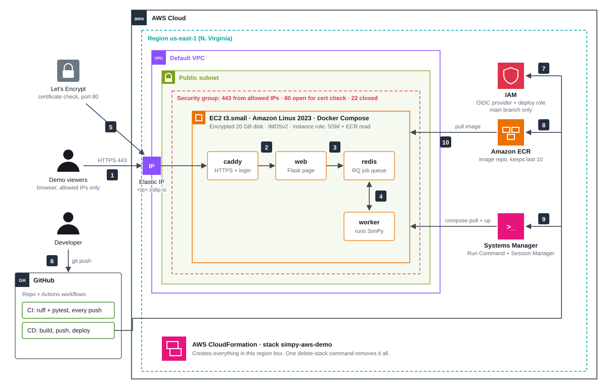

# simpy-aws-demo

A small SimPy web app hosted on AWS with CI/CD. It simulates a made-up production line: jobs arrive and pass through three stations in order (Cut → Assemble → Test), each with N machines. On the web page you set machines per station, arrival rate and hours to simulate, press Run, and get jobs finished, utilization per station and the bottleneck.

The app is a Flask web page plus a Redis job queue (RQ) and a separate worker that runs the simulation, so long runs never block the page.

## Architecture



**Running a simulation**

1. A viewer opens `https://<ip>.sslip.io`. The security group only lets in port 443 from allowed IPs.
2. Caddy handles HTTPS, asks for a password and passes the request to the Flask web app.
3. Pressing Run puts a job on the Redis queue.
4. The worker takes the job, runs the SimPy model and saves the results to Redis for the page to show.
5. Let's Encrypt checks the site over port 80, and Caddy gets and renews the certificate on its own.

**Shipping a change**

6. Every push runs CI on GitHub Actions (ruff + pytest).
7. When CI passes on main, the CD workflow gets a one-hour AWS login from the deploy role through OIDC. No AWS keys are stored anywhere, and only this repo's main branch can use the role.
8. CD builds the Docker image, tagged with the commit SHA, and pushes it to ECR.
9. CD sends [`deploy/remote-deploy.sh`](deploy/remote-deploy.sh) to the instance as an SSM Run Command and waits for it to finish.
10. On the instance, the script pulls the new image from ECR and copies the compose file and Caddyfile out of it, so they always match the code. It reads the password hash from SSM Parameter Store, then runs `docker compose up -d`.

To redeploy without a code change: `gh workflow run CD`.

## AWS services and cost

All AWS resources are in one CloudFormation template, [`infra/stack.yml`](infra/stack.yml), in us-east-1.

| Service | What it does here | Est. cost / month |
|---|---|---|
| EC2 (t3.small, x86) | One server running Docker Compose: caddy, web, redis, worker. x86 so GitHub's normal runners build the image without cross-building. | $15.18 |
| EBS (20 GB gp3, encrypted) | The server's disk | $1.60 |
| Elastic IP | Fixed public address, so the `<ip>.sslip.io` name and HTTPS certificate stay valid | $3.65 |
| ECR | Private Docker image repository. Keeps the last 10 images and scans each push. | under $0.50 |
| IAM | GitHub OIDC login + deploy role (push images, send deploy commands to this one instance); instance role (SSM + read images) | $0 |
| Systems Manager | Run Command for deploys; Session Manager for an admin shell, so SSH (port 22) stays closed | $0 |
| CloudFormation | Creates and deletes everything above in one go (`infra/up.sh`, `infra/down.sh`) | $0 |
| SSM Parameter Store | Holds the bcrypt hash of the site password (SecureString), outside the repo and the stack | $0 |
| VPC + security group | Default VPC; 443 from allowed IPs, 80 open for the certificate check | $0 |
| **Total** | | **about $21** |

Outside AWS (all free): GitHub Actions for CI/CD, Let's Encrypt for the certificate, and [sslip.io](https://sslip.io) for a DNS name that points at the IP, so no domain has to be bought.

Costs are us-east-1 on-demand list prices for a server running all month (730 hours). Deleting the stack brings the cost to $0.

**Does the cost grow with use?** Almost none of it does:

- EC2, disk and the Elastic IP are billed by the hour, whether the site is busy or idle.
- ECR storage is capped because only the last 10 images are kept.
- SSM, IAM and CloudFormation are free however often they are used.
- Data out is covered by the 100 GB/month free allowance, and only allowed IPs can reach the site.
- One exception: a t3 instance starts in CPU "unlimited" mode. If long, heavy simulations keep the CPU above its 20% baseline until its saved credits run out, AWS charges $0.05 per vCPU-hour for the extra. Normal demo use stays under the baseline and costs nothing extra. The worst case, both vCPUs at 100% all month, adds about $58. Setting the instance to "standard" CPU mode removes this: the server slows down instead of billing more.

## Repository layout

| Path | What it is |
|---|---|
| `src/simpy_aws_demo/sim.py` | The SimPy model of the production line |
| `src/simpy_aws_demo/app.py` | Flask pages, the RQ queue and the `flask worker` command |
| `tests/` | pytest tests (Redis faked with fakeredis) |
| `Dockerfile` | One image for both the web app (gunicorn) and the worker |
| `deploy/compose.yml`, `deploy/Caddyfile` | What runs on the server: caddy, web, worker, redis |
| `deploy/remote-deploy.sh` | Deploy script the CD workflow runs on the server through SSM |
| `infra/stack.yml` | CloudFormation template for every AWS resource |
| `infra/up.sh`, `infra/down.sh` | Bring the whole thing up or take it down |
| `.github/workflows/ci.yml`, `cd.yml` | CI (ruff, pytest) and CD (build, push, deploy) |

## Run locally

Needs [uv](https://docs.astral.sh/uv/) and a Redis server on `localhost:6379` (or set `REDIS_URL`).

```sh
uv run flask --app simpy_aws_demo.app run      # web page on http://127.0.0.1:5000
uv run flask --app simpy_aws_demo.app worker   # in a second terminal
uv run pytest
uv run ruff check
```

## Bring it up and take it down

```sh
bash infra/up.sh     # create or update the stack, set GitHub variables, deploy; prints the site address
bash infra/down.sh   # delete everything (asks you to type "delete"); cost goes to $0
```

`up.sh` allows HTTPS from your current public IP, or pass another one: `bash infra/up.sh 1.2.3.4`. It takes about 15 minutes on a fresh stack, mostly waiting. Each new stack gets a new Elastic IP, so the `<ip>.sslip.io` address changes after a down and up. Run `up.sh` again whenever your home IP changes.

Before the first `up.sh`: log in with `aws login`, log in to `gh` as the repo owner, and store the login password hash once in SSM Parameter Store as `/simpy-aws-demo/auth-hash` (`up.sh` prints the commands if it is missing). `down.sh` keeps that parameter, so later relaunches skip this step.

`up.sh` stores three repo variables that the CD workflow reads: `AWS_ROLE_ARN`, `INSTANCE_ID` and `SITE_NAME`.

Using a fork: change the `GitHubRepo` default in `infra/stack.yml` to your repo's OIDC subject prefix. This repo uses GitHub's immutable form (`owner@id/name@id`); `gh api repos/OWNER/REPO/actions/oidc/customization/sub` shows yours.

`aws cloudformation describe-stacks --stack-name simpy-aws-demo` shows the instance ID, IP, site name, ECR URI and deploy role ARN.
